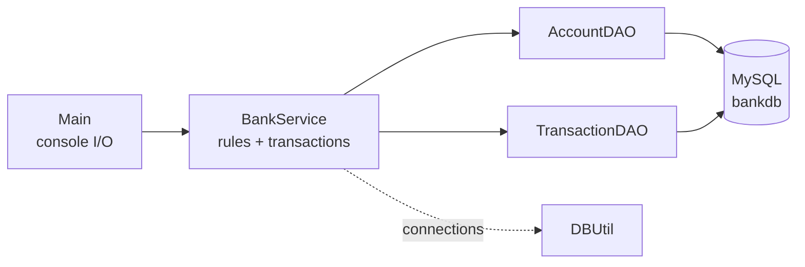
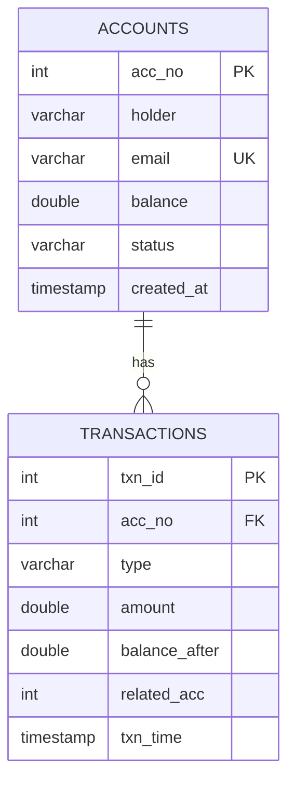

# Console Banking System


A menu-driven banking application built with **core Java and JDBC** (no frameworks). It demonstrates a clean layered design, safe database access with `PreparedStatement`, and proper **transaction management** for money movement.

## Table of Contents
- [Features](#features)
- [Tech Stack](#tech-stack)
- [Architecture](#architecture)
- [Project Structure](#project-structure)
- [Database Design](#database-design)
- [Getting Started](#getting-started)
- [Usage](#usage)
- [Key Design Decisions](#key-design-decisions)
- [Test Scenarios](#test-scenarios)
- [Known Limitations](#known-limitations)
- [Future Improvements](#future-improvements)
- [Author](#author)
- [License](#license)

## Features

| # | Feature | Notes |
|---|---|---|
| 1 | Create account | Name, email, opening deposit; returns the generated account number |
| 2 | View account | Holder, email, balance, status |
| 3 | Deposit | Updates the balance and records a history row in one transaction |
| 4 | Withdraw | Rejected if the balance would go below zero |
| 5 | Transfer | Atomic debit + credit; any failure rolls back both |
| 6 | Mini statement | Last 5 transactions, newest first |
| 7 | List accounts | Paginated, 5 per page |
| 8 | Close account | Allowed only when the balance is zero |

## Tech Stack

- **Language:** Java 17+
- **Database:** MySQL 8.x
- **Data access:** JDBC (MySQL Connector/J 8.4.0)
- **Patterns:** DAO, Service layer, POJO models, custom unchecked exception

## Architecture



| Layer | Responsibility |
|---|---|
| `Main` | Reads input, calls the service, prints results. Contains no SQL. |
| `BankService` | Validates input, enforces business rules, owns transaction boundaries (`commit` / `rollback`). |
| `AccountDAO`, `TransactionDAO` | One SQL operation per method. They receive a `Connection` from the caller. |
| `DBUtil` | The single place that knows how to create a connection. |
| `BankException` | Unchecked exception that keeps raw `SQLException` out of the UI layer. |

## Project Structure

```
.
├── schema.sql
├── README.md
└── src/com/bank/
    ├── Main.java
    ├── model/
    │   ├── Account.java
    │   └── Transaction.java
    ├── dao/
    │   ├── AccountDAO.java
    │   ├── AccountDAOImpl.java
    │   ├── TransactionDAO.java
    │   └── TransactionDAOImpl.java
    ├── service/
    │   └── BankService.java
    ├── util/
    │   └── DBUtil.java
    └── exception/
        └── BankException.java
```

## Database Design



- `balance` has a `CHECK (balance >= 0)` constraint as a second line of defence.
- `type` is one of `DEPOSIT`, `WITHDRAW`, `TRANSFER_IN`, `TRANSFER_OUT`.
- `related_acc` holds the other account in a transfer and is `NULL` otherwise.

## Getting Started

### Prerequisites
- JDK 17 or later
- MySQL 8.x running locally
- [MySQL Connector/J](https://dev.mysql.com/downloads/connector/j/) 8.x JAR

### 1. Clone the repository
```bash
git clone https://github.com/<your-username>/<your-repo>.git
cd <your-repo>
```

### 2. Create the database
```bash
mysql -u root -p < schema.sql
```
This creates `bankdb`, both tables, and three sample accounts.

### 3. Configure the connection
Credentials are read from environment variables, so no password is stored in source control.

| Variable | Default |
|---|---|
| `DB_URL` | `jdbc:mysql://localhost:3306/bankdb` |
| `DB_USER` | `root` |
| `DB_PASS` | `change_me` |

```bash
# Linux / macOS
export DB_PASS=your_mysql_password

# Windows (Command Prompt)
set DB_PASS=your_mysql_password
```

### 4. Build and run
Place the Connector/J JAR in a `lib/` folder, then:

```bash
# Linux / macOS
mkdir -p out
javac -d out $(find src -name "*.java")
java -cp "out:lib/mysql-connector-j-8.4.0.jar" com.bank.Main
```

```bat
:: Windows
mkdir out
dir /s /b src\*.java > sources.txt
javac -d out @sources.txt
java -cp "out;lib/mysql-connector-j-8.4.0.jar" com.bank.Main
```

**Using an IDE (IntelliJ / Eclipse):** add the Connector/J JAR as a library, mark `src` as the source root, and run `com.bank.Main`.

## Usage

Sample session (illustrative):

```
===== CONSOLE BANK =====
1. Create account
2. View account
3. Deposit
4. Withdraw
5. Transfer
6. Mini statement (last 5)
7. List all accounts
8. Close account
0. Exit
Choose an option: 5
From account: 1
To account: 2
Amount: 5000
Transfer successful.

Choose an option: 4
Account number: 3
Amount: 99999
Error: Insufficient funds or account not active
```

Every failure prints a clear message and leaves the data unchanged.

## Key Design Decisions

1. **`PreparedStatement` everywhere.** All values are bound as parameters, which prevents SQL injection.
2. **Try-with-resources for every JDBC object.** `Connection`, `PreparedStatement`, and `ResultSet` are always closed, even on errors.
3. **Transactions are owned by the service layer.** DAO methods accept a `Connection`, so several DAO calls can join one transaction. A balance change and its history row always commit or roll back together.
4. **One reusable transaction helper.** `inTransaction(...)` commits on success, rolls back on any failure, and restores auto-commit, so the pattern is written once.
5. **Atomic balance check.** Withdrawals use `UPDATE ... WHERE balance + ? >= 0`, so the "enough money?" check and the update are a single statement, with no check-then-update race.
6. **Deadlock-safe transfers.** Transfers always touch the lower account number first, so two opposite transfers (A to B and B to A) lock rows in the same order.
7. **Fail closed.** Any exception results in a rollback and an error message, never a silent success.
8. **Pagination with `LIMIT ? OFFSET ?`** and a stable `ORDER BY acc_no`.

## Test Scenarios

| Scenario | Expected result |
|---|---|
| Create an account with an existing email | "Email already registered", nothing inserted |
| Withdraw more than the balance | Rejected, balance and statement unchanged |
| Transfer to a non-existent account | Rejected, and the source balance is **unchanged** |
| Transfer to the same account | Rejected before any database call |
| Deposit or withdraw zero or a negative amount | Rejected before any database call |
| Close an account with a non-zero balance | Rejected |
| Mini statement after several operations | Newest first, with correct `balance_after` values |
| Database unavailable | Clear error message, no crash, no half-completed transfer |

## Known Limitations

- Money is stored as `DOUBLE` for simplicity. A production system should use `DECIMAL` with `BigDecimal` to avoid floating-point rounding.
- There is no authentication; any user of the console can operate any account.
- A new database connection is opened per operation. A connection pool (such as HikariCP) would be the production choice.
- "Insufficient funds" and "account not active" share one message because a single conditional update cannot tell them apart.

## Future Improvements

- [ ] Replace `DriverManager` with a HikariCP connection pool
- [ ] Use `DECIMAL` and `BigDecimal` for monetary values
- [ ] Add a PIN per account, stored as a BCrypt hash
- [ ] Add JUnit tests for the service layer
- [ ] Export the mini statement to CSV
- [ ] Migrate to Spring Boot with Spring Data JPA as a follow-up project


## License

This project is released under the [MIT License](LICENSE).